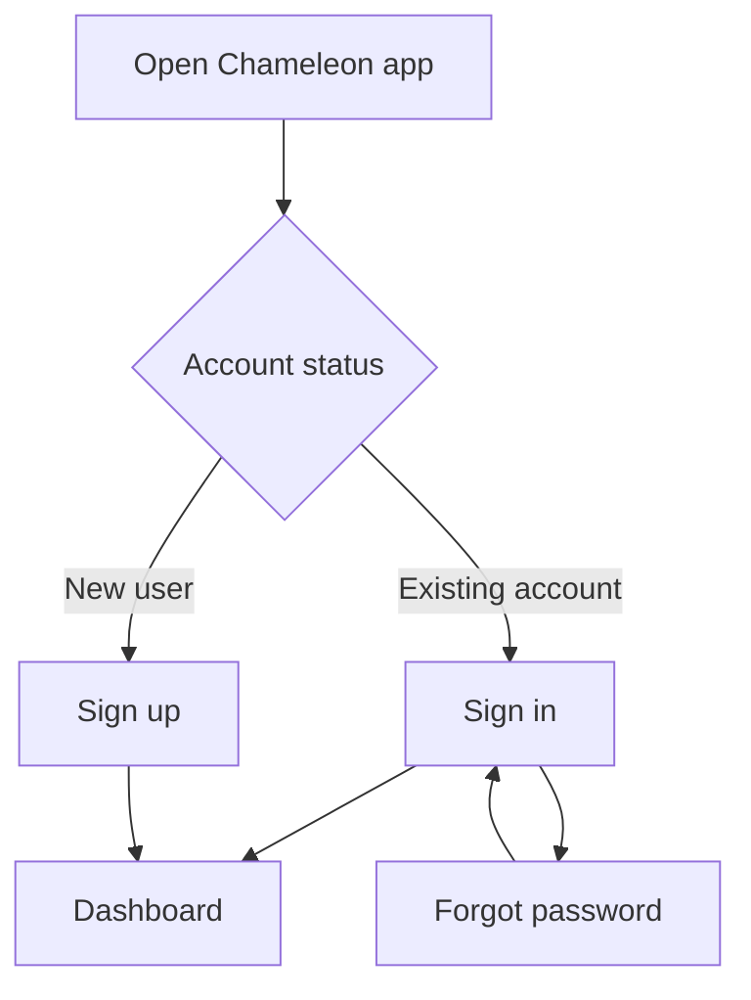
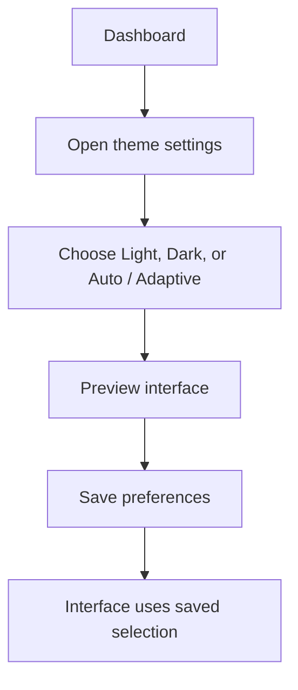
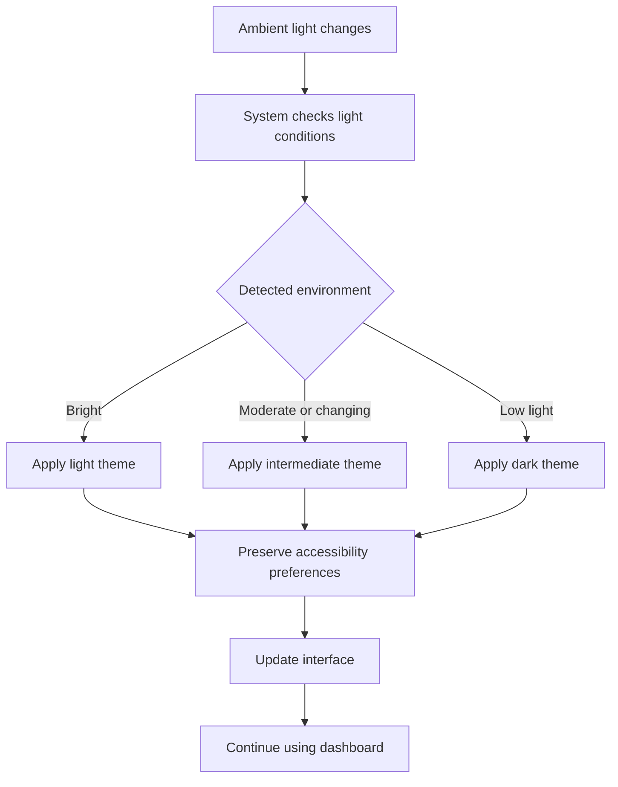
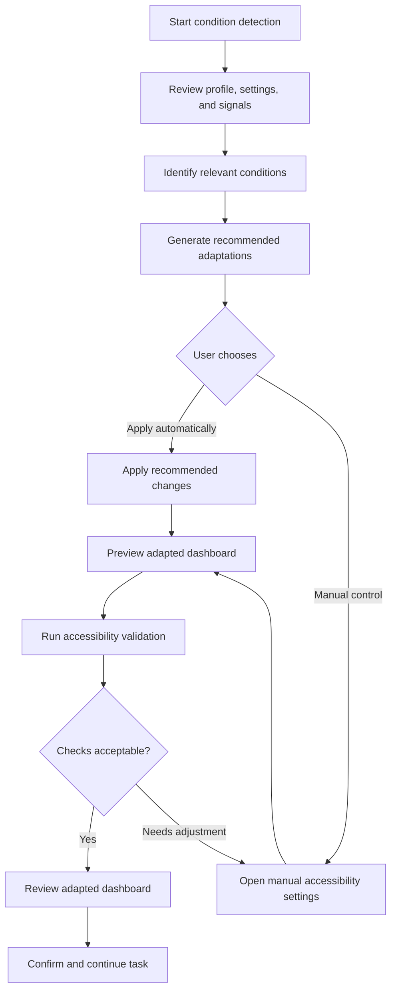
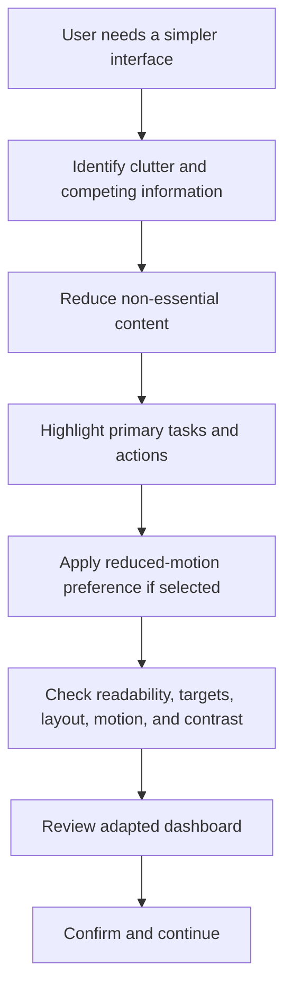

# Chameleon - Adaptive Dashboard for Accessible Digital Experiences

> **An adaptive dashboard concept that reshapes the interface around user preferences, accessibility needs, and changing environmental conditions.**

Chameleon explores how a digital workspace can become easier to read, navigate, and use by adapting its presentation instead of forcing every user into the same interface. The design brings together an accessible task dashboard, configurable accessibility preferences, contextual condition detection, automatic adaptation recommendations, manual overrides, and recovery paths when an adaptation cannot be applied.

This repository contains the UX flow, low-, mid-, and high-fidelity design flows, and a recorded walkthrough of the design. It documents a **UX/UI design prototype**; it should not be interpreted as a deployed application or as proof that sensor detection, voice input, authentication, or automatic adaptation are connected to working services.

---

## Contents

- [Project Overview](#project-overview)
- [The Problem and Design Goal](#the-problem-and-design-goal)
- [Design Principles](#design-principles)
- [Core Experience](#core-experience)
- [Adaptive Accessibility Model](#adaptive-accessibility-model)
- [End-to-End User Flows](#end-to-end-user-flows)
- [Dashboard and Task Management](#dashboard-and-task-management)
- [Accessibility and Appearance Settings](#accessibility-and-appearance-settings)
- [Detection, Adaptation, and User Control](#detection-adaptation-and-user-control)
- [Error Handling and Recovery](#error-handling-and-recovery)
- [Accessibility Validation](#accessibility-validation)
- [Screen Inventory](#screen-inventory)
- [Design Evolution](#design-evolution)
- [Repository Structure](#repository-structure)
- [How to Review the Project](#how-to-review-the-project)
- [Prototype Scope and Limitations](#prototype-scope-and-limitations)
- [Potential Next Steps](#potential-next-steps)

---

## Project Overview

**Chameleon** is an adaptive dashboard concept for accessible digital experiences. It combines two connected ideas:

1. **A dashboard for managing accessibility-related work.** Users can review tasks, track progress, identify overdue work, enter a focused task view, and review achievements.
2. **An interface that can adapt to the user and their context.** Text size, contrast, theme, interactive target size, voice assistance, and information density can be adjusted through preferences or through a proposed condition-detection and recommendation flow.

The design aims to preserve user preferences while making the current interface more suitable for the task and environment. For example, a change from a bright environment to a low-light environment may lead to a different theme, while the user's text-size and voice preferences remain in place.

### At a glance

| Item | Description |
|---|---|
| Project | Chameleon |
| Product concept | Adaptive dashboard for accessible digital experiences |
| Project focus | UX flow, accessibility preferences, contextual adaptation, and dashboard experience |
| Design deliverables | UX flow plus low-, mid-, and high-fidelity screen flows |
| Walkthrough | Recorded Chameleon screen-cast |
| Current status | UX/UI design prototype and documentation |

---

## The Problem and Design Goal

A fixed interface may not work equally well for every person or in every context. Small text can be difficult to read, compact controls can be difficult to select precisely, bright or dim surroundings can affect visibility, and a crowded screen can make it harder to identify the next action. Some users may also prefer or need voice assistance, reduced motion, or a simpler presentation.

Chameleon explores a more flexible approach:

- Let users configure accessibility and appearance preferences.
- Represent relevant user, accessibility, and environmental signals in a condition-detection flow.
- Translate detected conditions into understandable recommendations.
- Provide an automatic adaptation path while keeping manual settings available.
- Preview and validate the adapted interface before the user continues.
- Preserve existing accessibility preferences when the visual theme changes.
- Provide clear recovery actions if detection or adaptation fails.

The intended result is an interface that can reduce unnecessary effort while keeping important tasks and controls available.

---

## Design Principles

### 1. Adapt the presentation, not the user's goal

The dashboard should continue to support the user's task. Adaptations change how information is presented - such as text scale, contrast, target size, or layout density - rather than hiding the user's ability to complete the task.

### 2. Keep the user in control

Automatic recommendations are presented alongside manual settings. Users can review recommendations, override individual areas, save changes, or return to the dashboard.

### 3. Preserve preferences

Theme changes should not silently reset other accessibility preferences. The design repeatedly calls out preservation of text size, contrast preference, voice settings, and interaction preferences while the theme or interface surfaces are updated.

### 4. Make the interface easier to scan

Primary tasks and actions should be prominent. Secondary information can be minimized or grouped when a simpler interface is needed, while remaining accessible.

### 5. Make changes understandable

Detection states, recommended responses, previews, validation results, and error messages are represented as separate parts of the experience. Users should be able to understand what was detected, what is proposed, and what they can do next.

### 6. Provide a fallback

If a sensor is unavailable or an adaptation cannot be applied, the design provides retry, manual configuration, safe-default, and return-to-dashboard paths rather than leaving the user at a dead end.

---

## Core Experience

The design is organized around the following product areas:

| Area | What it covers |
|---|---|
| Account access | Sign in, sign up, forgot-password entry, and alternative sign-in options |
| Dashboard | Overview metrics, tasks, activity, quick actions, progress, and navigation |
| Task execution | Task details, focus mode, timer/progress, overdue work, and recovery actions |
| Progress | Completion summaries, weekly progress, trends, streaks, and achievements |
| Accessibility preferences | Text size, contrast, voice assistance, and adaptive response settings |
| Appearance | Light, dark, and automatic/adaptive theme options with previews |
| Condition detection | A concept for reviewing profile, accessibility baseline, environment, and other signals |
| Adaptive response | Recommendations, previews, automatic application, and manual overrides |
| Simplified interface | Reduced visual clutter and a stronger focus on essential actions |
| Validation and recovery | Accessibility checks, user review, retry, manual settings, and fallback states |

---

## Adaptive Accessibility Model

Chameleon groups the proposed adaptations into five main areas. These are presented as design concepts and interaction flows in the supplied materials.

| User need or condition represented in the design | Proposed interface response |
|---|---|
| Motor movement or precision difficulty | Enlarge buttons, cards, icons, and other hit targets; increase spacing; use a strong focus highlight; consider confirmation for risky actions |
| Low vision or difficulty reading small text | Increase typography and line spacing, scale labels, and reflow content so that text and controls do not overlap |
| Ambient-light or contrast needs | Use light, intermediate, dark, high-contrast, or adaptive-colour presentation as appropriate to the selected mode and detected environment |
| Cognitive load or distraction | Reduce visual clutter, group related information, minimize secondary sections, and highlight the next important tasks and actions |
| Voice or touch preference | Provide voice prompts, task narration, audio feedback, alerts, listening-state feedback, and a proposed voice interaction path |

### Examples of the proposed adaptations

- **Motor:** the design illustrates normal and expanded interaction states, including an example target-size change from approximately 44 px to 60 px. These values are design examples in the prototype, not a claim of implemented sizing behavior.
- **Text:** typography controls illustrate 100%, 120%, and 140% text scaling options and line-height options such as 1.2x and 1.5x. The preview emphasizes reflow without overlap.
- **Contrast:** the design includes default contrast, high contrast, adaptive colour, low-light tuned contrast, and bright-light tuned contrast options. A separate settings screen also presents Default, High Contrast, Dark Mode, and Custom choices.
- **Voice:** the design covers voice prompts, audio feedback for actions, task narration, alerts, listening mode, and a test prompt.
- **Cognitive load:** essential tasks and primary actions move forward in the information hierarchy, while secondary information is reduced or collapsed rather than permanently removed.

---

## End-to-End User Flows

The UX flow document describes several connected journeys. The diagrams below summarize those journeys in a repository-friendly format.

### 1. Open the app and reach the dashboard



The high-fidelity flow includes an account-access screen with email, password, a Remember me option, and a forgot-password action. Alternative sign-in presents SSO and email-link options; the supplied design labels these alternatives as placeholders.

### 2. Manual appearance selection



The flow emphasizes that the selected preference should be retained for the next visit.

### 3. Ambient-light adaptation



The detailed screen flow also shows monitoring information such as current theme, detected condition, sensor status, last update, and recent adaptations. The example re-evaluation cadence is shown as every 2-5 minutes and is explicitly a placeholder in the design.

### 4. Detect a need and apply an accessibility response



### 5. Simplify a visually busy dashboard



The UX flow describes the motivation for this path as too much information, distracting elements, difficulty focusing, or a need for a simpler view.

---

## Dashboard and Task Management

The dashboard is designed as the central workspace. It brings together a summary of the user's work, recent activity, progress, and quick access to important actions.

### Overview and activity

The overview screen presents example metrics for:

- Active tasks
- Tasks due today
- Accessibility score
- Recent task and activity updates
- Suggested actions and alerts

The supplied example uses values such as 12 active tasks, 4 due today, and a 92% accessibility score. These are **illustrative placeholder values**, not live product analytics.

The task/activity area includes examples such as:

- Review screen states
- Respond to a missing-alt-text alert
- Fix keyboard focus behavior
- Run a contrast check
- Update an accessibility checklist
- Configure adaptive labels
- Generate a report
- Attach evidence

### Progress and achievements

Progress is presented using readable summaries and simplified chart concepts. The screens include:

- Weekly progress and completion rate
- Tasks completed by day
- Current progress and completed-task counts
- Completed, in-progress, and blocked task summaries
- Streaks and achievements

Example achievement labels include **Contrast Champion**, **Keyboard Pro**, and **Voice Ready**. Their descriptions connect achievement status to contrast checks, verified focus order, and validated voice prompts.

### Focus mode

Focus Mode reduces clutter by showing one focused task and a smaller set of actions. The sample task is **Fix keyboard focus order**, with an example estimated duration of 25 minutes and a high priority. The proposed actions include:

- Mark Complete
- Start Timer
- Next Step
- Preferences
- Exit Focus

The next-step guidance asks the user to tab through interactive elements and verify focus-ring visibility.

### Empty state, quick add, and overdue work

The dashboard also documents states for users who have no active tasks, including guidance to create a first task, import data, or continue to a task-creation action.

Quick Add includes template examples such as:

- Accessibility audit
- Contrast check

Overdue-task examples include updating alt-text coverage, fixing focus-trap behavior, and enabling voice prompts for alerts. Recovery controls include **Reschedule** and **Mark as Reviewed**, with options to view details or recover overdue items.

---

## Accessibility and Appearance Settings

The settings experience is divided into clear sections so users can adjust the parts of the interface that matter to them.

### Text size and readability

The text-size flow offers Small, Medium, Large, and Extra Large choices. A preview area shows sample headings and body text so users can inspect readability before saving.

The detailed adaptation controls additionally illustrate typography scaling, line-height adjustments, scaling for interface labels, and a reflow mode intended to prevent text and controls from overlapping.

### Contrast settings

The design includes contrast choices and preview states for:

- Default contrast
- High contrast
- Dark mode
- Custom contrast (placeholder)
- Adaptive colour based on ambient light
- Low-light tuned and bright-light tuned contrast

Preview panels compare text and interface elements on light and dark surfaces. The goal is to keep text, buttons, and controls distinguishable as the surrounding theme changes.

### Voice assistance

The voice-assistance screens cover:

- Voice prompts
- Audio feedback for actions
- Task narration
- Alerts for errors and warnings
- Listening-mode selection, including a push-to-talk placeholder
- Voice status and last-feedback indicators
- A test voice prompt and example alert

Example prompt copy in the design includes: “Task started. Choose the next step.” An example alert says: “I couldn't detect your selection. Try again.” These are prototype examples, not evidence of a connected speech service.

### Appearance and theme

The theme-selection experience includes Light Mode, Dark Mode, and Auto / Adaptive. The detailed ambient-light flow adds an Intermediate theme for changing or moderate light conditions.

The design distinguishes between:

- The theme or surface appearance that may change with the environment.
- The user's other accessibility preferences, which should remain preserved.

Users can preview a selection, save it, manually override automatic theme behavior, or reset to Auto.

### Reduced motion

A separate Reduced Motion Settings screen lets the user choose whether to minimize non-essential animation and motion effects. The preview represents cards and lists remaining static, with no animated transitions in the example.

---

## Detection, Adaptation, and User Control

### Condition-detection concept

The condition-detection screen describes a system check involving the user's profile, settings, accessibility baseline, environment, and sensor signals. The UX flow also proposes detecting accessibility settings already enabled on the device and adapting the interface accordingly. The example system-check panel represents categories such as:

- Profile and accessibility baseline
- Environment and ambient light
- Motor movement and precision difficulty
- Vision and text-size suitability
- Cognitive load and distraction signals
- Voice or touch preference

This is a conceptual design for the detection experience. The supplied materials do not specify a production sensor implementation, classification model, permissions model, or backend service.

### From detected condition to recommended response

The Adaptive Response screen presents a detected condition alongside the recommended adaptation. Examples include:

| Detected condition | Recommended response in the design |
|---|---|
| Motor movement/precision difficulty | Enlarge hit targets and controls |
| Low vision or small text | Increase typography and reflow the layout |
| Low ambient light or contrast need | Apply high-contrast or adaptive-colour presentation |
| Cognitive load or distraction | Simplify the layout and highlight essential information |
| Voice preference | Enable voice prompts and alerts |

Users can review the recommended response and choose **Apply Auto-Adaptation** or open manual settings.

### Manual override

Manual settings are designed to override individual recommendations without removing the automatic option. The documented sections include:

- Motor
- Text
- Contrast
- Voice
- Simplify

The user can keep automatic adaptation enabled, switch to manual mode, select the areas to override, preview draft changes, and choose **Save & Apply**. The User Override screens summarize whether automatic adaptation is enabled, when it was last applied, and whether the override is partial or user-edited.

### Combined adaptive dashboard

The design brings the adaptation areas together in a combined dashboard preview. It represents:

- Larger interactive cards and buttons
- Larger labels and reflowed text
- Improved contrast
- Voice enabled/active status
- Simplified secondary content
- An adaptive status indicator

The user can accept the result or continue to manual override controls.

---

## Error Handling and Recovery

The design includes explicit fallback paths so that an unsuccessful detection or adaptation does not block the user from continuing.

### Detection and adaptation errors

| Scenario | Recovery options represented |
|---|---|
| Ambient-light sensor unavailable | Retry detection, choose a theme manually, or return to the dashboard |
| Detection error or failed classification | Retry detection or use manual theme selection |
| Automatic adaptation fails | Retry automatic adaptation or open Manual Accessibility Settings |
| A requested preference cannot be applied | Explain the issue, retain the current setting where possible, and offer a supported option |
| User wants to avoid automatic changes | Use manual settings or safe defaults |

The design includes example error copy such as “Cannot access detection sensors right now” and “Could not apply accessibility changes.” The exact cause and technical error details are placeholders.

### Network and general application states

The UX flow also describes offline and general error handling:

- Explain the problem clearly.
- Offer a retry action.
- Where appropriate, show cached tasks or progress and the last-updated data.
- Allow limited functionality while offline.
- Retry synchronization when the connection returns.
- Account for session timeout, invalid data, and unexpected errors.

### Preference preservation

When automatic adaptation fails, the documented recovery approach allows the user to keep the current settings and adjust preferences manually. The user should not lose saved accessibility preferences simply because a detection or theme change cannot be applied.

---

## Accessibility Validation

Before confirming an adapted dashboard, the design includes a validation checklist. The checklist is represented by five areas:

| Validation area | What the design asks the user to review |
|---|---|
| Text readability | Text size and contrast remain readable |
| Interactive target size | Buttons and controls remain easy to select |
| Layout clarity | Simplified grouping and information hierarchy remain clear |
| Reduced-motion preference | The calmer motion experience is respected |
| Colour contrast | Text and controls remain distinguishable in light and dark themes |

If an item needs attention, the user can return to settings, adjust the preference, and review the dashboard again. The flow then offers a user-review screen, a confirmation step, and a **Continue task** action.

These screens document accessibility-oriented design checks. They do not constitute a formal accessibility audit or a claim of WCAG conformance.

---

## Screen Inventory

The three fidelity exports each contain a 118-page screen sequence. The following table groups the content by the page ranges in those exports.

| Pages | Screens and content |
|---|---|
| 1-4 | Chameleon landing screen, introductory illustration, account sign-in, and alternative sign-in (SSO/email link placeholders) |
| 5-19 | Dashboard overview, task/activity, progress summary and trend, navigation state, task cards, quick progress, Focus Mode, timer/progress, empty dashboard, Quick Add, overdue tasks, recovery controls, and achievements |
| 20-30 | Accessibility Settings, text-size selection and preview, contrast selection and preview, voice test, appearance/theme selection, adaptive appearance, and dashboard/chart previews |
| 31-53 | Condition Detection, detected conditions, Adaptive Response, manual settings, motor accessibility and settings, low-vision/text adaptation and reflow preview, contrast adaptation, voice assistance, simplified interface, combined adaptive layout, user override, and fallback/error recovery |
| 54-89 | Ambient-light monitoring, light-level and adaptation history, bright/intermediate/low-light detection states, theme recommendations, automatic/manual theme controls, Light/Intermediate/Dark dashboard examples, applied-theme results, appearance overrides, preserved preferences, and sensor/detection fallback |
| 90-104 | Standard dashboard review, cognitive-accessibility detection, reasons for simplification, simplified dashboard preview, highlighted primary tasks, and minimized but accessible secondary information |
| 105-113 | Reduced Motion Settings, motion preview, accessibility validation checklist, validation explanation, adapted-dashboard review, and confirm-adaptation screen |
| 114-118 | Adaptation-failed state, retry/manual recovery options, Manual Accessibility Settings, adjustable preferences, and final accessible-interface outcome |

The separate 50-page UX Flow PDF documents the broader navigation and decision logic: app entry and account access, dashboard and theme settings, ambient-light detection, accessibility preferences, user-condition adaptations, simplified-interface flow, adaptation failure, manual customization, and task continuation.

---

## Design Evolution

The project is documented through three fidelity levels. The exports retain the same overall 118-page screen sequence while developing the visual treatment across the design stages.

### Low-Fidelity Flow

The low-fidelity version establishes the structure of the experience: screen hierarchy, content grouping, navigation, states, and the order of user actions. Its visual treatment is primarily neutral and wireframe-like, allowing the flow and information architecture to be reviewed without relying on detailed visual styling.

### Mid-Fidelity Flow

The mid-fidelity version develops the screen layouts with more defined visual hierarchy, component treatment, and colour accents. It helps communicate how key cards, controls, previews, and information groups are expected to appear.

### High-Fidelity Flow

The high-fidelity version carries the same broad experience into a more developed visual presentation, including the stronger colour treatment, dashboard states, adaptive previews, and more complete screen styling.

### UX Flow

The separate UX Flow document focuses on how users move through the product and how the interface responds to different conditions. It includes the ambient-light theme path, motor, vision, voice, and cognitive adaptations, plus the simplified-interface and fallback paths.

---

## Repository Structure

A simple structure for publishing the supplied deliverables on GitHub is:

```text
Chameleon/
├── README.md
├── assets/
│   ├── Chameleon-UX-Flow.pdf
│   ├── Chameleon-Low-Fidelity-Flow.pdf
│   ├── Chameleon-Mid-Fidelity-Flow.pdf
│   └── Chameleon-High-Fidelity-Flow.pdf
└── demo/
    └── Chameleon-ScreenCast.mp4
```

Use `assets/` for the design documents and exported visual material, and `demo/` for the screen-recording walkthrough. The links below expect the filenames shown in this structure. Rename the uploaded files accordingly, or update the links to match the actual names in your repository.

### Design documents

- [UX Flow](./assets/Chameleon-UX-Flow.pdf)
- [Low-Fidelity Flow](./assets/Chameleon-Low-Fidelity-Flow.pdf)
- [Mid-Fidelity Flow](./assets/Chameleon-Mid-Fidelity-Flow.pdf)
- [High-Fidelity Flow](./assets/Chameleon-High-Fidelity-Flow.pdf)

### Demo walkthrough

- [Watch the Chameleon ScreenCast](./demo/Chameleon-ScreenCast.mp4)

If a shareable Figma prototype or design-file URL is available, add it here:

- **Figma:** `[Add Figma prototype or design-file URL]`

---

## How to Review the Project

No application installation is required to review the current repository deliverables.

A recommended review order is:

1. Start with the **UX Flow** to understand navigation, decision points, and the overall adaptation journeys.
2. Review the **Low-Fidelity Flow** to understand the screen hierarchy and interaction structure.
3. Review the **Mid-Fidelity Flow** to see the more developed layouts and visual hierarchy.
4. Review the **High-Fidelity Flow** for the most developed visual presentation.
5. Watch the **ScreenCast** for a guided walkthrough of the design canvas and prototype screens.

For a focused review, follow the ambient-light journey first, then the condition-detection and Adaptive Response journey, and finally the simplified-interface and manual-recovery journey.

---

## Prototype Scope and Limitations

The uploaded material documents the experience and visual behavior of a UX/UI prototype. It does **not** include application source code, a running backend, or verified production integrations.

The following items are explicitly represented as placeholders, previews, sample data, or conceptual behavior in the design:

- SSO and email-link sign-in options.
- Dashboard counts, accessibility score, completion rates, chart values, activity, and achievement data.
- Ambient-light sensor sampling, thresholds, confidence, periodic re-evaluation, and condition classification.
- Detection of motor, vision, cognitive-load, voice, or touch signals.
- Automatic application of adaptive theme and accessibility recommendations.
- Voice playback, audio feedback, listening state, and voice interaction.
- Advanced/custom contrast tuning and some settings previews.
- Network caching, limited offline behavior, and retry/recovery behavior.

The design files do not specify a technology stack, framework, database, API contract, authentication provider, sensor hardware, data-retention policy, or deployment platform. These should be selected and documented separately if the project moves into implementation.

---

## Potential Next Steps

The design materials point to several areas that could be developed if the concept moves beyond the prototype:

1. **Define implementation architecture:** choose the application platform, component system, persistence layer, and integration boundaries.
2. **Specify adaptation rules:** define the signals, thresholds, confidence handling, precedence, and fallback rules for every adaptation category.
3. **Build preference persistence:** make text, contrast, theme, voice, interaction, and reduced-motion preferences survive sessions and remain user-controllable.
4. **Implement responsive reflow:** verify that typography scaling, expanded hit targets, and simplified layouts work without overlap across supported screen sizes.
5. **Implement accessible feedback:** provide reliable labels, keyboard operation, visible focus, screen-reader announcements, and understandable state changes.
6. **Test environmental adaptation:** validate theme changes under bright, moderate, changing, and low-light conditions, including sensor-unavailable cases.
7. **Validate with users:** test the experience with people who have different accessibility needs and preferences, and revise the adaptation model from observed results.
8. **Measure outcomes:** define meaningful measures for task completion, readability, navigation effort, error recovery, and user control before claiming measurable improvements.

---

## Closing Note

Chameleon is built around a simple idea: **accessibility should be adaptable, understandable, and under the user's control.** By combining task management, configurable preferences, context-aware recommendations, simplified presentation, and clear fallback paths, the design explores a more flexible way to interact with a digital workspace.

The supplied UX Flow, fidelity flows, and ScreenCast together provide the design rationale, screen-level experience, and walkthrough for reviewing the concept.

## **Video Demonstration:** https://drive.google.com/file/d/1vFWY0ZKveyvKU8ZYrynrTxCfWGIvw8v_/view?usp=drivesdk
